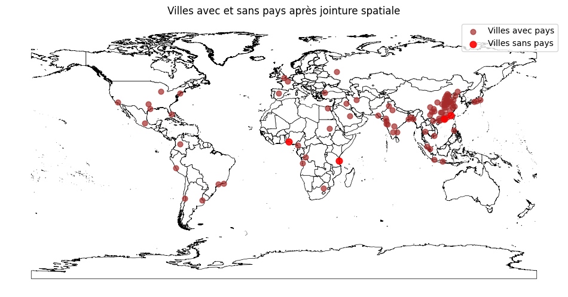

# Analyse géospatiale des grandes villes du monde avec Pandas et GeoPandas

Un pipeline géospatial complet sur les 100 plus grandes villes du monde : chargement et nettoyage des données avec **pandas**, conversion en **GeoDataFrame**, **jointure spatiale** avec les frontières des pays (shapefile), cartographie avec **matplotlib** et validation des fonctions principales par des **tests unitaires**.

> Projet universitaire, baccalauréat en informatique (profil sciences des données), Université du Québec à Trois-Rivières (UQTR).




*En marron : les villes associées à un pays. En rouge : les 4 villes que la jointure spatiale n'a pas pu associer.*

---

## Étapes du pipeline

1. **Chargement** d'un fichier CSV de 100 villes (`ville`, `pays`, `population`, `latitude`, `longitude`) et d'un shapefile des frontières des pays.
2. **Nettoyage** des données :
   - suppression des lignes sans coordonnées, sans pays ou sans population ;
   - filtrage des valeurs impossibles (latitude hors de [-90, 90], longitude hors de [-180, 180], population nulle ou négative).
3. **Statistiques descriptives** sur la population : 99 villes valides, d'environ 5,7 à 37,7 millions d'habitants, avec une moyenne d'environ 11,5 millions et une médiane d'environ 9 millions. Quelques mégapoles tirent la moyenne vers le haut.
4. **Conversion** du DataFrame en GeoDataFrame de points, dans le système de coordonnées `EPSG:4326` (coordonnées GPS).
5. **Correction de la projection :** le shapefile n'avait aucun système de coordonnées (`crs = None`). On lui attribue `EPSG:4326` pour qu'il corresponde aux villes avant la jointure.
6. **Jointure spatiale** entre les villes et les pays (`predicate="within"`) pour trouver le pays dans lequel se trouve chaque ville.
7. **Visualisation** des frontières et des villes sur une carte du monde, en mettant en évidence les villes non associées.

## Résultats

- **95 villes sur 99** ont été associées à un pays.
- **4 villes n'ont pas été associées :** Lagos, Quanzhou, Dar es Salaam et Hong Kong. Ce sont toutes des villes côtières : un léger décalage des coordonnées ou des frontières simplifiées placent le point juste à l'extérieur du polygone du pays. C'est une limite classique des jointures « point dans un polygone ». Une amélioration possible serait une jointure au polygone le plus proche (`gpd.sjoin_nearest`) ou une petite zone tampon autour de chaque point.

## Structure du projet

```
.
├── analyse_geospatiale.ipynb   # Notebook complet de l'analyse, avec les résultats
├── geo_utils.py                # Fonctions réutilisables : nettoyage, conversion, jointure spatiale
├── test_geo_utils.py           # 7 tests unitaires (unittest)
├── images/cities-map.png
└── requirements.txt
```

## Tests unitaires

Les fonctions principales de `geo_utils.py` sont couvertes par 7 tests :

| Fonction | Ce qui est vérifié |
|---|---|
| `nettoyer_villes` | supprime les valeurs manquantes, les pays manquants, les coordonnées invalides et les populations invalides |
| `convertir_en_geodf` | crée la géométrie des points et définit le système de coordonnées |
| `faire_jointure_spatiale` | trouve le pays quand la ville est dans un polygone, et ne renvoie aucun pays quand elle est à l'extérieur |

Les tests utilisent de petits DataFrames et polygones créés pour l'occasion : ils fonctionnent sans aucun fichier de données.

```bash
python -m unittest -v test_geo_utils
```

## Lancer le projet

```bash
pip install -r requirements.txt
```

Place ensuite les données dans un dossier `data/` :

- `data/villes.csv` : liste des villes, adaptée de [simplemaps World Cities](https://simplemaps.com/data/world-cities)
- `data/pays.shp` (avec ses fichiers `.shx` et `.dbf`) : frontières des pays, tirées de [World Administrative Boundaries (Opendatasoft)](https://public.opendatasoft.com/explore/dataset/world-administrative-boundaries/export/)

Ouvre `analyse_geospatiale.ipynb` dans Jupyter et exécute toutes les cellules. Les fichiers de données ne sont pas inclus dans ce dépôt.

## Outils

Python · pandas · GeoPandas · Shapely · matplotlib · unittest · Jupyter Notebook

## Autrice

**Awa Sermé**, baccalauréat en informatique (sciences des données), UQTR
[LinkedIn](https://www.linkedin.com/in/awa-serm%C3%A9/)
